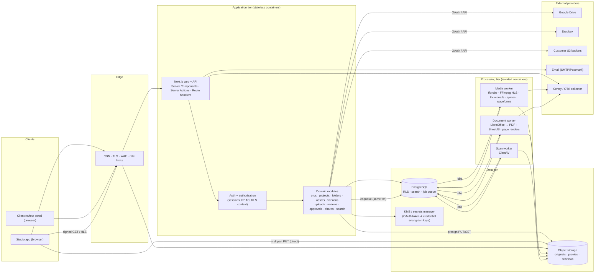
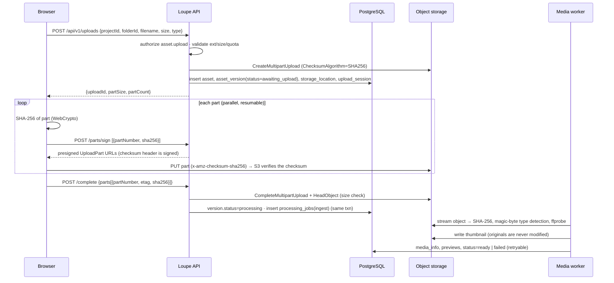

# Loupe — Architecture & Implementation Plan (Phase 0)

> **Loupe** is a working codename for the platform: a review, collaboration and
> asset-management system for post-production studios, agencies and their clients.
> The name is isolated to `src/config/brand.ts` and this documentation, so it can
> be changed in one place.

This document is the Phase 0 deliverable. It covers:

1. [Recommended technical architecture](#1-recommended-technical-architecture)
2. [Technology stack and reasons](#2-technology-stack)
3. [Database schema](#3-database-schema) (full DDL in [`DATABASE.md`](./DATABASE.md))
4. [System architecture diagram](#4-system-architecture-diagram)
5. [Frontend modules and backend services](#5-frontend-modules-and-backend-services)
6. [External services and cost estimates](#6-external-services-and-estimated-costs)
7. [Phased roadmap](#7-phased-development-roadmap)
8. [Technical risks and limitations](#8-technical-risks-and-limitations)
9. [Roles and permissions](#9-roles-and-permissions)
10. [Core user journeys](#10-core-user-journeys)
11. [Storage abstraction](#11-storage-abstraction)

---

## 1. Recommended technical architecture

**A modular monolith for the product surface, plus separately deployed workers
for heavy media and document processing.**

```
 Browser ──HTTPS──▶ CDN ──▶ Web/API (Next.js, Node runtime) ──▶ PostgreSQL
    │                                │                              ▲
    │  signed PUT/GET (direct)       │ enqueue (same DB txn)        │
    ▼                                ▼                              │
 Object storage ◀──────────── Workers (media, document, scan) ──────┘
 (S3 / R2 / MinIO)                 FFmpeg · LibreOffice · ClamAV
```

### Why a modular monolith for the web/API tier

- A studio product's domain (projects, assets, versions, comments, approvals,
  shares) is tightly relational. Splitting it into microservices early would
  turn joins into network calls and cross-service authorization into a
  distributed-systems problem.
- One deployable keeps the app shippable at every phase (Development Rule 15).
- Boundaries are enforced in code instead: each domain lives in
  `src/server/modules/<domain>` with its own service and validation. UI code
  never touches the database; it calls services through server actions or route
  handlers.

### Why the workers are separate services

- **FFmpeg and LibreOffice are CPU- and memory-heavy and run on untrusted
  input.** They must not share a process (or ideally a host) with the API that
  holds sessions and secrets. Workers run in their own containers with no
  inbound network, a reduced filesystem and per-job time and memory limits.
- They scale on a different signal (queue depth) from the web tier
  (request rate).
- Specialised tooling (GPU transcoding, LibreOffice headless, ClamAV) has
  different base images and patch cadences.

### Key architectural decisions

| Decision | Choice | Rationale |
|---|---|---|
| Uploads | Browser → object storage directly via **presigned multipart URLs** | Multi-GB camera files never pass through the app servers. Parallel parts, resume, and per-part SHA-256 checksums verified by the storage service. |
| Downloads and streaming | Short-lived **signed GET URLs** issued after an authorization check, optionally via CDN signed URLs | No public buckets and no long-lived URLs. Credentials never reach the browser. |
| Job queue | **PostgreSQL table queue**: `processing_jobs` rows claimed with `FOR UPDATE SKIP LOCKED`, with leases, attempts and backoff | The job row *is* the domain record users see (status, error, retry button). It is enqueued in the *same transaction* that creates the asset version, so there are no orphaned jobs or lost events. No extra Redis cluster to run or back up. Media jobs are coarse (seconds to minutes each), far below the throughput limits of this design. A Redis/BullMQ or SQS adapter can replace the claim loop if throughput ever demands it. |
| Tenant isolation | **Application authorization plus PostgreSQL row-level security (RLS)** | Every service call carries an authorization context. Independently, the app connects as a non-owner role and every tenant table has an RLS policy bound to a transaction-local `app.org_id`. A missing `WHERE organization_id = …` returns nothing instead of leaking another studio's data. |
| Authentication | First-party **database sessions** (opaque 256-bit tokens, SHA-256-hashed at rest, HttpOnly/SameSite cookies) with **Argon2id** password hashing | Revocable sessions (an admin can sign a user out everywhere), no JWT revocation problem, and no third-party identity lock-in. SSO (SAML/OIDC) plugs in as another credential type later. |
| Search | PostgreSQL full-text search plus `pg_trgm` | Good up to millions of rows, permission filtering in the same query, no sync pipeline. A Meilisearch/OpenSearch adapter is a Phase 6 option. |
| Video delivery | **HLS (fMP4)** proxies generated by FFmpeg, served from storage via CDN | Browsers cannot play ProRes, DNxHR or MXF. HLS gives adaptive renditions and seekable delivery. The original is never modified. |
| Documents | **LibreOffice headless → PDF**, rendered in the browser with **PDF.js**; spreadsheets parsed with **SheetJS** in a worker into a sheet/cell JSON model | One page-based review surface for PDF/DOCX/PPTX. Spreadsheets need cell-level fidelity, which PDF conversion destroys. |

---

## 2. Technology stack

| Layer | Selection | Why (cost · scale · security · maintainability · compatibility) |
|---|---|---|
| Language | **TypeScript 5 (strict)** end to end | One language across UI, API and workers, with shared types for API contracts and domain enums. |
| Web framework | **Next.js 16 (App Router, Cache Components) + React 19** | Server Components keep data access on the server (no API keys or direct DB access in client bundles). Server Actions give typed RPC for mutations, and route handlers serve the upload API. Large ecosystem and hosting portability (Node container, not tied to one vendor). |
| Styling | **Tailwind CSS 4** with design tokens as CSS variables | Tokens live in one stylesheet and are themeable per organization (branding). No runtime CSS-in-JS cost. |
| Database | **PostgreSQL 16+** | RLS, JSONB for custom metadata, full-text search, `pg_trgm`, mature managed offerings (RDS, Cloud SQL, Neon, Crunchy). |
| ORM / migrations | **Drizzle ORM + drizzle-kit**, with hand-written SQL migrations for RLS, triggers and roles | SQL-transparent and fully typed. Supports RLS-friendly transaction wrappers. Migrations are plain SQL files that are easy to review. |
| Validation | **Zod 4** | The same schemas validate on the client (forms) and the server (actions and route handlers). |
| Auth | Own session module, `@node-rs/argon2` | See section 1. Small, auditable surface. |
| Object storage | **S3 API** via `@aws-sdk/client-s3` (AWS S3, **Cloudflare R2**, MinIO, Wasabi, Backblaze B2) | One adapter covers most providers. R2 is recommended as the default native store because its egress is free (video review is egress-dominated). |
| Queue | **PostgreSQL `SKIP LOCKED` queue** (`src/server/jobs`) | Transactional enqueue, leases, retries with exponential backoff, retry from the UI. No extra infrastructure. |
| Media | **FFmpeg / ffprobe 6+** (system binaries) | Industry standard for probing, thumbnails, sprite sheets, HLS. ProRes/DNx/MXF decode support. |
| Images | **sharp (libvips)** | Fast, memory-efficient thumbnails. TIFF/WEBP/PNG/JPEG. |
| Documents | **LibreOffice 7+ headless** (Phase 3), **PDF.js**, **SheetJS** | Free and self-hostable. Collabora/OnlyOffice are optional upgrades for higher Office fidelity. |
| Malware scanning | **ClamAV** (clamd) worker stage | Free, scriptable. Limits on very large media are documented (see risks). |
| Email | `Mailer` interface: console adapter in development, SMTP/Postmark/Resend adapter in production | Provider-agnostic. Notifications are written to the DB first and emailed asynchronously. |
| Testing | **Vitest** (unit + integration against real PostgreSQL and MinIO), **Playwright** (end to end) | Integration tests exercise RLS and storage for real instead of mocking them. |
| Observability | OpenTelemetry traces, structured JSON logs (pino), **Sentry** for errors | Vendor-neutral instrumentation. |
| Runtime and deployment | Docker images for `web` and `worker`, run on any container platform (ECS/Fargate, Fly.io, Render, Kubernetes) | Workers need system binaries (FFmpeg, LibreOffice), so a container platform is required for them. Serverless functions are not suitable for transcoding. |

---

## 3. Database schema

The complete relational schema — every entity in the specification, with
relationships, indexes, constraints and RLS — is in **[`DATABASE.md`](./DATABASE.md)**.
Phase 1 implements the identity, tenancy, project, folder, asset, version,
storage, processing, activity and audit tables as real migrations in
`drizzle/`. Later phases add their tables through new migrations.

Principles:

- UUID primary keys (`gen_random_uuid()`), `timestamptz` everywhere.
- Every tenant-owned row carries `organization_id`, including child tables like
  `asset_versions`, so RLS policies never need joins.
- Soft deletes (`deleted_at`) for user content, so restore and audit are possible.
- Append-only tables (`audit_logs`, `approval_events`) are protected by triggers
  that reject `UPDATE`/`DELETE`.
- No binary media in PostgreSQL. Only storage *locations* (connection + key or
  external id).

---

## 4. System architecture diagram



### Request lifecycle (authenticated, tenant-scoped)

1. `proxy.ts` performs a cheap cookie-presence check and redirects anonymous
   users away from `/o/*`. It is an optimisation only; it is not the security
   boundary.
2. The page, action or route handler calls `requireOrgContext(slug)`. That
   validates the session in the DB, resolves the org membership and role, and
   returns an `AuthContext`.
3. The service checks the permission (`authorize(ctx, 'asset.upload', { projectId })`).
4. The service runs its queries inside `withTenant(ctx, tx => …)`. That opens
   a transaction as the restricted `loupe_app` role and runs
   `set_config('app.org_id', …, true)`, so RLS applies.
5. Side effects (activity event, audit log, job enqueue) are written in the same
   transaction.

### Upload lifecycle



---

## 5. Frontend modules and backend services

### Frontend (route groups under `src/app`)

| Module | Routes | Phase |
|---|---|---|
| Auth | `/login`, `/signup`, `/invite/[token]` | 1 |
| Onboarding | `/onboarding` (create first organization) | 1 |
| App shell | `/o/[org]/…` persistent sidebar, org switcher, global search, user menu | 1 |
| Dashboard | `/o/[org]` | 1 (reviews/approvals widgets in 2/4) |
| Workspaces | `/o/[org]/workspaces` | 1 |
| Projects | `/o/[org]/projects`, `/o/[org]/projects/[id]` (asset browser), `/settings`, `/members`, `/activity` | 1 |
| Asset viewer | `/o/[org]/assets/[id]` (metadata, versions, processing status, preview) | 1 → review player in 2, document viewers in 3 |
| Shared with me | `/o/[org]/shared` | 1 |
| Search | `/o/[org]/search` | 1 (advanced filters in 6) |
| Storage | `/o/[org]/storage` (usage analytics, connections) | 1 (external connectors in 5) |
| Administration | `/o/[org]/settings/{general,members,roles,audit}` | 1 |
| Reviews and Notifications | `/o/[org]/reviews`, `/o/[org]/notifications` | 2 / 4 |
| Client portal | `/r/[token]` (no studio chrome, studio branding) | 2 (links), 4 (full portal) |

Shared UI lives in `src/components/ui` (design system primitives) and
`src/components/app` (composed domain widgets: uploader, asset grid, breadcrumbs).
Client state is local (React state, `useOptimistic`). The server is the source
of truth, and no global client store is needed.

### Backend services (modules in `src/server/modules`)

| Service | Responsibility |
|---|---|
| `auth` | Sign-up, sign-in, sessions, password hashing, rate limiting of credential endpoints |
| `authz` | Permission catalog, role resolution, `authorize()`, project access checks |
| `organizations` | Org creation, settings, branding, membership, invitations |
| `workspaces` | Grouping projects inside an org |
| `projects` | CRUD, status, client info, custom metadata, members, favorites |
| `folders` | Nested tree, move with cycle checks, breadcrumbs |
| `assets` | Asset CRUD, kind classification, move, bulk operations, versions |
| `uploads` | Multipart session lifecycle, part signing, completion, abort, resume |
| `storage` | `StorageProvider` adapter registry, connections, locations, usage analytics |
| `processing` | Job records, enqueue, retry, worker handlers (ingest, thumbnails; HLS and docs later) |
| `activity` | User-facing project and org activity feed |
| `audit` | Security-relevant, append-only audit trail |
| `search` | Permission-aware FTS across projects, folders, assets, users |
| *(Phase 2+)* `reviews`, `comments`, `annotations`, `shares`, `approvals`, `notifications`, `connectors` | |

---

## 6. External services and estimated costs

> Prices are list prices as of late 2026 and change frequently. Verify them
> before budgeting. Figures are monthly and exclude tax.

### Unit prices used

| Service | Unit price (approx.) |
|---|---|
| Cloudflare R2 storage | ~$0.015 / GB-month · **$0 egress** · ~$4.50 per million writes · ~$0.36 per million reads |
| AWS S3 Standard | ~$0.023 / GB-month · ~$0.09 / GB internet egress (lower via CloudFront) |
| S3 Glacier Instant Retrieval (archive tier) | ~$0.004 / GB-month |
| Managed PostgreSQL (2 vCPU / 8 GB, HA) | ~$150–400 |
| Container compute (web, 2× 1 vCPU / 2 GB) | ~$40–100 |
| Media workers (CPU, 4–8 vCPU, autoscaled) | ~$100–600 depending on transcode hours |
| Email (Postmark / Resend) | ~$15–50 |
| Sentry (Team) | ~$26+ |
| Google Drive API / Dropbox API | Free API quotas. **Google restricted-scope verification (CASA security assessment)** can cost ~$500–4,500 per year through an assessor |

### Scenario estimates

| Scenario | Assumptions | Storage | Egress | Compute + DB + misc | **Total (R2)** | Total (S3 + CloudFront) |
|---|---|---|---|---|---|---|
| Small studio | 20 users · 3 TB originals + 1 TB proxies · 5 TB/mo review playback · 50 transcode hours/mo | ~$60 | $0 | ~$350 | **~$410** | ~$900 |
| Mid-size post house | 100 users · 30 TB + 8 TB proxies · 40 TB/mo playback · 400 transcode hours/mo | ~$570 | $0 | ~$1,300 | **~$1,900** | ~$5,500 |
| Multi-tenant SaaS (50 studios) | 600 TB total · 500 TB/mo playback | ~$9,000 | $0 | ~$6,000 | **~$15,000** | ~$50,000+ |

**Recommendation:** use R2 (or another zero- or low-egress S3-compatible
provider) as the default native store, with lifecycle rules that move old
versions to an archive tier. Keep AWS S3 as a supported option for studios that
need data in their own AWS account (customer-managed buckets, Phase 5).

---

## 7. Phased development roadmap

| Phase | Scope | Exit criteria |
|---|---|---|
| **0 — Architecture** | This document, `DATABASE.md`, permission model, risks | Reviewed and agreed |
| **1 — Core platform** ✅ *implemented: see README for exact scope* | Auth, orgs, members and invitations, roles, workspaces, projects, nested folders, asset management, versions (upload new version), direct multipart resumable uploads with checksums, ingest worker (hash, type detection, ffprobe, thumbnails), storage usage, activity, audit log, permission-aware search, dashboard | A studio can sign up, invite a teammate, create projects and folders, upload multi-GB files with progress and resume, see thumbnails and metadata, download securely, and every action is authorized server-side and isolated by RLS. Integration and end-to-end tests pass. |
| **2 — Video review** ✅ *implemented: see [REVIEW.md](./REVIEW.md)* | Progressive MP4 proxy ladder (CFR H.264, short GOP) with HLS deferred to Phase 6, sprite thumbnails for the timeline, frame-accurate player (`requestVideoFrameCallback`, SMPTE timecode incl. drop-frame), timecode comments and threads, mentions, filters, annotation layer (vector, normalized coordinates). External review links moved to Phase 4 with the client portal | Comment on frame N of a 23.976 fps ProRes upload and land on the same frame after a reload in Chrome, Safari and Firefox |
| **3 — Document review** ✅ *implemented* | PDF.js viewer, DOCX/PPTX → PDF via sandboxed LibreOffice, spreadsheet JSON model with cell comments, image zoom/pan with region comments, unified comment anchor model | All formats in section 6 of the spec reviewable with page, slide, cell or region anchors |
| **4 — Collaboration** | Version stacks UI, approval workflow (states, requests, reviewers, deadlines), client portal, notifications (in-app + email), review assignments, custom roles editor | Full client approval loop with a permanent history |
| **5 — Hybrid storage** | Connector framework, Google Drive, Dropbox, customer S3. Reference vs. import modes, credential encryption with a KMS, token refresh and reconnect | Import and reference flows with verified access, and expired-token recovery |
| **6 — Professionalization** | Version comparison (video sync, image overlay, PDF page diff, sheet diff), analytics, advanced search, load and security testing, CDN signed URLs, backups and DR drills, production deployment | SLOs defined and met, penetration test findings remediated |

---

## 8. Technical risks and limitations

| # | Risk / limitation | Impact | Mitigation |
|---|---|---|---|
| 1 | **Browser video is not natively frame-accurate.** `currentTime` is a float, and seeking lands on the nearest decodable frame. | Comments may land one frame off | Store comments as an integer **frame number** plus the rational frame rate (`24000/1001`). Seek to `(frame + 0.5) / fps` for mid-frame targeting. Verify with `requestVideoFrameCallback().mediaTime`. Proxies are encoded at constant frame rate with short GOPs. |
| 2 | **Variable-frame-rate sources** (phones, screen recordings) | Frame numbers are ambiguous | Detect VFR in ffprobe (`r_frame_rate` ≠ `avg_frame_rate`). Normalize the proxy to CFR and anchor comments to proxy presentation time. Show a "VFR source — frame numbers refer to the review proxy" badge. |
| 3 | **ProRes, DNxHR, MXF and most 10-bit/HDR material cannot play in browsers** | No direct playback of originals | Always transcode an H.264 (and optional HEVC/AV1) HLS proxy. The original is still available for download. |
| 4 | **Colour accuracy.** Browsers apply OS colour management inconsistently, and HDR (PQ/HLG) tone-mapping varies. | Colourists cannot grade-check in a browser | Tag proxies BT.709 explicitly, and add an HDR → SDR tone-mapped proxy alongside the HDR one. Document that browser review is **not a reference monitor**. |
| 5 | **Office rendering fidelity via LibreOffice** (fonts, SmartArt, complex PPTX animations) | Pages may differ from Microsoft Office | Install the common font packs. Always offer the original file for download. Collabora/OnlyOffice integration is an upgrade path. Label previews "rendered preview". |
| 6 | **Large spreadsheets** (100k+ rows) | Browser memory | Worker parses into sheet chunks (row windows). Virtualized grid. Formulas are kept alongside displayed values and never dropped. |
| 7 | **Google OAuth restricted scopes** (`drive.readonly`) require an annual CASA security assessment | Cost and weeks of lead time before public launch | Use `drive.file` + Google Picker (non-restricted) for import-on-pick. Start verification early. |
| 8 | **Untrusted files hitting FFmpeg/LibreOffice/libvips** (parser CVEs) | Remote code execution in the worker | Workers in isolated containers, unprivileged user, no inbound network, egress limited to storage and DB, seccomp, per-job timeouts. Patch cadence. Magic-byte validation before processing. |
| 9 | **Malware scanning large media.** ClamAV has practical size limits (~2–4 GB) | Huge files unscanned | Scan documents and archives fully. Media files are treated as data, never executed. Flag "not scanned (size)" in metadata. |
| 10 | **Egress costs** on S3-class providers | Review playback can cost more than storage | R2 by default, CDN caching of proxies, and serve proxies (not originals) for playback |
| 11 | **Upload limits.** S3 allows at most 10,000 parts and 5 TiB objects. Browser hashing costs CPU. | Very large files | Dynamic part size (≥ 8 MiB, grown so parts ≤ 10,000). Hash per part in parallel in a streaming fashion. Resume state in IndexedDB/localStorage. |
| 12 | **RLS performance and correctness** | Slow queries or blocked queries | Policies are a simple equality on the indexed `organization_id`. Every tenant table has a leading `organization_id` index. Integration tests assert cross-tenant invisibility. |
| 13 | **HEVC playback support varies** (Chrome needs hardware decode, Firefox has partial support) | Inconsistent playback | H.264 baseline proxy is always generated. HEVC/AV1 are optional extra renditions. |
| 14 | **Checksum support differs across S3-compatible providers** | Integrity verification may not work everywhere | The adapter reports `capabilities.partChecksums`. When it is unsupported, fall back to `Content-MD5` per part and a server-side SHA-256 recomputed by the ingest worker. |
| 15 | **Realtime collaboration** (presence, live comments) | Not in Phase 1 | Phase 2/4 adds SSE via PostgreSQL `LISTEN/NOTIFY`, or a managed pub/sub when scaling horizontally |

---

## 9. Roles and permissions

Permissions are a fixed **catalog** defined in code
(`src/server/authz/permissions.ts`). **Roles** are rows in `roles` that hold a
set of permission keys. System roles are seeded by migration. Organizations can
add custom roles later (Phase 4 UI; the schema already supports them).

A user's **organization role** grants org-scoped permissions. Owner and
Administrator also carry `project.access_all`, which grants every project
permission in every project of that org. Everyone else gets project permissions
only through a **project membership**, which has its own project role. A
project role can never exceed the member's org-role ceiling: a Client can only
be added to a project as Client or Guest.

| Permission | Owner | Admin | Project Mgr | Editor | Reviewer | Client | Guest |
|---|:-:|:-:|:-:|:-:|:-:|:-:|:-:|
| `org.manage_billing` | ✓ | | | | | | |
| `org.manage_settings`, `org.manage_members`, `org.manage_roles`, `org.manage_storage`, `org.manage_integrations`, `org.view_audit_log` | ✓ | ✓ | | | | | |
| `org.view_internal` (dashboard, workspaces, member directory) | ✓ | ✓ | ✓ | ✓ | ✓ | | |
| `project.create` | ✓ | ✓ | ✓ | | | | |
| `project.access_all` | ✓ | ✓ | | | | | |
| `project.view` | ✓ | ✓ | ✓ | ✓ | ✓ | ✓ | ✓ |
| `project.edit`, `project.manage_members` | ✓ | ✓ | ✓ | | | | |
| `project.delete` | ✓ | ✓ | ✓ | | | | |
| `folder.create`, `folder.edit` | ✓ | ✓ | ✓ | ✓ | | | |
| `folder.delete`, `asset.delete` | ✓ | ✓ | ✓ | ✓ | | | |
| `asset.upload`, `asset.edit`, `asset.version` | ✓ | ✓ | ✓ | ✓ | | | |
| `asset.download` | ✓ | ✓ | ✓ | ✓ | ✓ | ✓ | |
| `asset.processing_retry` | ✓ | ✓ | ✓ | ✓ | | | |
| `comment.create` *(Phase 2)* | ✓ | ✓ | ✓ | ✓ | ✓ | ✓ | ✓ |
| `comment.resolve` *(Phase 2)* | ✓ | ✓ | ✓ | ✓ | | | |
| `share.create` *(Phase 2)* | ✓ | ✓ | ✓ | ✓ | | | |
| `review.manage` *(Phase 4)* | ✓ | ✓ | ✓ | | | | |
| `approval.decide` *(Phase 4)* | ✓ | ✓ | ✓ | | | ✓ | |

Guests are normally *not* organization members at all. They reach content only
through share links (Phase 2), which carry their own capability flags (comment,
download, approve). The Guest role exists for invited-by-email guests who need
a persistent identity.

Enforcement happens in three layers: service-level `authorize()` (primary),
PostgreSQL RLS (tenant isolation, defense in depth), and UI hiding (convenience
only).

---

## 10. Core user journeys

1. **Studio onboarding.** Sign up → create organization (slug) → default
   workspace is created → invite teammates (role) → copy or send the invitation
   link → teammate accepts and lands in the dashboard.
2. **Project setup.** Project manager → New project (name, client, workspace,
   status) → creates folder tree (`/Edit/Cuts`, `/Graphics`, `/Delivery`) →
   adds members with project roles.
3. **Ingest.** Editor drags 40 GB of camera files onto a folder → the uploads
   tray shows per-file progress and speed → a laptop sleeps mid-upload → on
   return the tray offers resume and only the missing parts are sent → files
   show "Processing" → thumbnails and metadata (codec, fps, duration, TC) appear.
4. **New version.** Editor uploads `v2` of a cut onto the existing asset →
   the version history shows v1 and v2 → v2 becomes current. Comments stay on
   their versions (Phase 2).
5. **Review (Phase 2).** Reviewer opens a cut → plays → presses `C` at a frame
   → types a comment with an arrow drawing → editor jumps to the frame, fixes,
   resolves.
6. **Client approval (Phase 4).** PM creates a password-protected review link
   with approve permission and an expiry → client opens the branded portal →
   requests changes → v3 → client approves → the approval history records
   user, time, version and decision.
7. **Administration.** Admin views storage by project, user and provider →
   changes a member's role → reviews the audit log.

---

## 11. Storage abstraction

```ts
interface StorageProvider {
  readonly kind: 'object' | 'drive';
  readonly capabilities: {
    presignedUpload: boolean; multipart: boolean; partChecksums: boolean;
    presignedDownload: boolean; rangeReads: boolean; serverSideCopy: boolean;
  };
  // object-store operations (native S3/R2/MinIO, customer S3)
  createMultipartUpload(key, opts): Promise<{ uploadId }>;
  presignUploadPart(key, uploadId, partNumber, opts): Promise<SignedRequest>;
  completeMultipartUpload(key, uploadId, parts): Promise<{ etag }>;
  abortMultipartUpload(key, uploadId): Promise<void>;
  listUploadedParts(key, uploadId): Promise<Part[]>;      // resume
  head(key): Promise<ObjectHead | null>;
  presignDownload(key, opts): Promise<string>;
  getStream(key, range?): Promise<Readable>;
  put(key, body, opts): Promise<void>;                    // generated previews
  delete(key): Promise<void>;
}

interface ExternalConnector {  // Phase 5: Google Drive, Dropbox, …
  authorizeUrl(state): string;
  exchangeCode(code): Promise<EncryptedCredentials>;
  refresh(creds): Promise<EncryptedCredentials>;          // handles expiry
  list(folderRef, cursor?): Promise<ExternalListing>;
  stat(fileRef): Promise<ExternalFile>;                   // verifies access
  openStream(fileRef, range?): Promise<Readable>;         // import / processing
}
```

Every byte the platform knows about is a `storage_locations` row pointing at a
`storage_connections` row. The connection says *who holds the bytes* (the
platform's own bucket, or an org's Drive or Dropbox account). The
`asset_versions.storage_source` column distinguishes:

| `storage_source` | Meaning | Processing / streaming |
|---|---|---|
| `native` | Uploaded to and held by the platform | Allowed once the upload is completed and verified |
| `external_import` | Copied from a provider into native storage | Same as `native` once the copy is verified |
| `external_reference` | Bytes stay at the provider. Loupe stores the provider id and revision. | Only after `access_verified_at` is set by a successful `stat()`. Re-verified before each processing job, and shown as "Unavailable" when access is revoked. |
| *(previews)* | Generated derivatives (`previews` table) always live in native storage | — |

Original files are **never modified**. Derivatives are written under
`orgs/{org}/derived/{version}/…`, and originals under `orgs/{org}/originals/{version}/…`.
