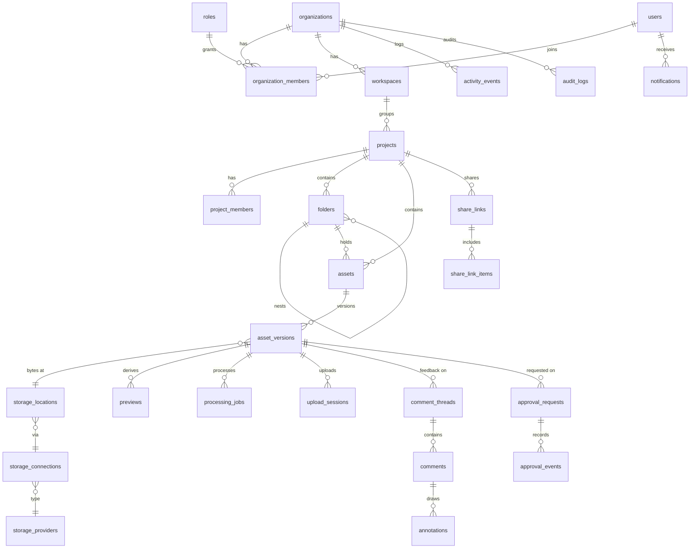

# Loupe — Database Schema

PostgreSQL 16+. This document is the **complete schema proposal** for every
phase. Tables marked **[P1]** exist today as migrations in `drizzle/`, and their
Drizzle definitions are in `src/server/db/schema.ts`. Other tables are added in
the phase noted. Their design is fixed here so earlier tables already carry the
columns and keys they need.

## Conventions

- `id uuid primary key default gen_random_uuid()` on every table, except pure
  join tables (composite PK) and reference catalogs (text PK).
- `created_at timestamptz not null default now()`, plus `updated_at` where rows are mutable.
- **Every tenant-owned table has `organization_id uuid not null`**, including
  children such as `asset_versions` and `comments`. RLS policies are then a
  single indexed equality with no joins. Composite foreign keys are not used to
  enforce same-org relationships. The service layer resolves parents inside the
  same RLS-scoped transaction, so a parent from another org is invisible and
  cannot be referenced.
- Soft delete: `deleted_at timestamptz` on user content (projects, folders, assets).
- Append-only tables (`audit_logs`, `approval_events`) are protected by a
  `BEFORE UPDATE OR DELETE` trigger that raises.
- Binary content is **never** stored in PostgreSQL. Only `storage_locations`
  pointers are.

## Row-level security model

```sql
-- Restricted login role used by the web app and workers. It owns nothing, so RLS applies.
create role loupe_app login password '…' nosuperuser nobypassrls;

create function app_org()  returns uuid language sql stable as
  $$ select nullif(current_setting('app.org_id',  true), '')::uuid $$;
create function app_user() returns uuid language sql stable as
  $$ select nullif(current_setting('app.user_id', true), '')::uuid $$;

-- Pattern applied to every tenant table:
alter table projects enable row level security;
create policy tenant_isolation on projects
  using (organization_id = app_org())
  with check (organization_id = app_org());
```

The app sets both values **transaction-locally** (`set_config(…, true)`) at the
start of every tenant transaction, so a pooled connection can never carry one
request's tenant into another. Operations that legitimately happen before a
tenant is known run on a separate *system* connection (the schema owner),
restricted to the narrow functions in `src/server/db/system.ts`: authentication,
session validation, invitation and share-link token lookup, and org creation.

Column-level grants give `loupe_app` no access to `users.password_hash`, and
`sessions` is not granted at all.

---

## Enumerations

```sql
create type project_status       as enum ('active','on_hold','completed','archived');
create type asset_kind           as enum ('video','audio','image','document','spreadsheet','presentation','archive','other');
create type review_status        as enum ('draft','in_progress','ready_for_review','in_review','changes_requested','approved','final');
create type storage_source       as enum ('native','external_import','external_reference');
create type processing_status    as enum ('awaiting_upload','processing','ready','failed');
create type upload_status        as enum ('active','completed','aborted');
create type job_status           as enum ('queued','running','succeeded','failed','cancelled');
create type role_scope           as enum ('organization','project');
create type member_status        as enum ('active','suspended');
create type connection_status    as enum ('active','needs_reauth','error','disconnected');
create type preview_kind         as enum ('thumbnail','poster','sprite','hls','proxy','pdf','page_image','waveform','sheet_model');
-- Phase 2+
create type anchor_type          as enum ('none','frame','frame_range','page','slide','sheet_cell','region');
create type thread_status        as enum ('open','resolved');
create type approval_decision    as enum ('approved','changes_requested','status_changed','comment');
create type approval_req_status  as enum ('open','approved','changes_requested','cancelled');
create type share_scope          as enum ('assets','folder','project');
```

---

## Identity and tenancy

```sql
-- [P1] Global identity (not tenant-scoped). Membership links users to orgs.
create table users (
  id                uuid primary key default gen_random_uuid(),
  email             text not null,                  -- stored lower-cased
  name              text not null,
  password_hash     text,                           -- argon2id; null for SSO-only users
  avatar_url        text,
  email_verified_at timestamptz,
  disabled_at       timestamptz,
  last_login_at     timestamptz,
  created_at        timestamptz not null default now(),
  updated_at        timestamptz not null default now()
);
create unique index users_email_uq on users (email);

-- [P1] Server-side sessions. id = sha256(token); the raw token exists only in the cookie.
create table sessions (
  id            text primary key,
  user_id       uuid not null references users(id) on delete cascade,
  expires_at    timestamptz not null,
  last_used_at  timestamptz not null default now(),
  ip            inet,
  user_agent    text,
  created_at    timestamptz not null default now()
);
create index sessions_user_idx on sessions (user_id);

-- [P1]
create table organizations (
  id                  uuid primary key default gen_random_uuid(),
  name                text not null,
  slug                text not null unique check (slug ~ '^[a-z0-9](?:[a-z0-9-]{1,46}[a-z0-9])$'),
  branding            jsonb not null default '{}',   -- {accentColor, logoLocationId, portalTitle}
  settings            jsonb not null default '{}',   -- {defaultShareExpiryDays, allowGuestDownloads, …}
  storage_quota_bytes bigint,                        -- null = unlimited (future plans/billing)
  plan                text not null default 'studio',
  created_at          timestamptz not null default now(),
  updated_at          timestamptz not null default now(),
  deleted_at          timestamptz
);

-- [P1] System roles: organization_id is null. Custom roles: org-specific.
create table roles (
  id              uuid primary key default gen_random_uuid(),
  organization_id uuid references organizations(id) on delete cascade,
  scope           role_scope not null,
  key             text not null,                  -- 'owner','admin','project_manager',…
  name            text not null,
  description     text not null default '',
  permissions     text[] not null,                -- keys from the code catalog
  is_system       boolean not null default false,
  rank            int not null default 0,         -- ordering in UI; ceiling checks
  created_at      timestamptz not null default now(),
  unique nulls not distinct (organization_id, scope, key)
);
-- RLS: organization_id is null OR organization_id = app_org()

-- [P1]
create table organization_members (
  id              uuid primary key default gen_random_uuid(),
  organization_id uuid not null references organizations(id) on delete cascade,
  user_id         uuid not null references users(id) on delete cascade,
  role_id         uuid not null references roles(id),
  status          member_status not null default 'active',
  invited_by      uuid references users(id),
  created_at      timestamptz not null default now(),
  updated_at      timestamptz not null default now(),
  unique (organization_id, user_id)
);
create index org_members_user_idx on organization_members (user_id);
-- RLS: organization_id = app_org() OR user_id = app_user()   (to list "my organizations")

-- [P1]
create table invitations (
  id              uuid primary key default gen_random_uuid(),
  organization_id uuid not null references organizations(id) on delete cascade,
  email           text not null,
  role_id         uuid not null references roles(id),
  project_id      uuid references projects(id) on delete cascade,     -- optional: invite straight into a project
  project_role_id uuid references roles(id),
  token_hash      text not null unique,
  invited_by      uuid not null references users(id),
  expires_at      timestamptz not null,
  accepted_at     timestamptz,
  accepted_by     uuid references users(id),
  revoked_at      timestamptz,
  created_at      timestamptz not null default now()
);
create index invitations_org_idx on invitations (organization_id, created_at desc);

-- [P1] Fixed-window rate limiter for credential endpoints (system connection only).
create table rate_limits (
  key          text primary key,
  window_start timestamptz not null,
  count        int not null
);
```

## Workspaces, projects and folders

```sql
-- [P1]
create table workspaces (
  id              uuid primary key default gen_random_uuid(),
  organization_id uuid not null references organizations(id) on delete cascade,
  name            text not null,
  description     text not null default '',
  created_by      uuid references users(id),
  created_at      timestamptz not null default now(),
  updated_at      timestamptz not null default now()
);
create unique index workspaces_name_uq on workspaces (organization_id, lower(name));

-- [P1]
create table projects (
  id               uuid primary key default gen_random_uuid(),
  organization_id  uuid not null references organizations(id) on delete cascade,
  workspace_id     uuid not null references workspaces(id),
  name             text not null,
  description      text not null default '',
  status           project_status not null default 'active',
  client_name      text,
  client_email     text,
  manager_user_id  uuid references users(id),
  cover_asset_id   uuid,                         -- fk → assets(id), cover = its current thumbnail
  metadata         jsonb not null default '{}',  -- custom key/value fields
  created_by       uuid references users(id),
  created_at       timestamptz not null default now(),
  updated_at       timestamptz not null default now(),
  deleted_at       timestamptz
);
create index projects_org_idx      on projects (organization_id, updated_at desc) where deleted_at is null;
create index projects_name_trgm    on projects using gin (name gin_trgm_ops);

-- [P1] Project-level role assignment
create table project_members (
  id              uuid primary key default gen_random_uuid(),
  organization_id uuid not null references organizations(id) on delete cascade,
  project_id      uuid not null references projects(id) on delete cascade,
  user_id         uuid not null references users(id) on delete cascade,
  role_id         uuid not null references roles(id),
  added_by        uuid references users(id),
  created_at      timestamptz not null default now(),
  unique (project_id, user_id)
);
create index project_members_user_idx on project_members (organization_id, user_id);

-- [P1]
create table project_favorites (
  organization_id uuid not null references organizations(id) on delete cascade,
  user_id         uuid not null references users(id) on delete cascade,
  project_id      uuid not null references projects(id) on delete cascade,
  created_at      timestamptz not null default now(),
  primary key (user_id, project_id)
);

-- [P1] Adjacency list. Depth is capped in the service (32). Cycles are rejected on move.
create table folders (
  id              uuid primary key default gen_random_uuid(),
  organization_id uuid not null references organizations(id) on delete cascade,
  project_id      uuid not null references projects(id) on delete cascade,
  parent_id       uuid references folders(id) on delete cascade,
  name            text not null,
  created_by      uuid references users(id),
  created_at      timestamptz not null default now(),
  updated_at      timestamptz not null default now(),
  deleted_at      timestamptz
);
create unique index folders_sibling_name_uq on folders (project_id, parent_id, lower(name))
  nulls not distinct where deleted_at is null;
create index folders_parent_idx  on folders (organization_id, project_id, parent_id);
create index folders_name_trgm   on folders using gin (name gin_trgm_ops);
```

## Assets, versions and storage

```sql
-- [P1] Catalog of provider types (reference data, not tenant-scoped)
create table storage_providers (
  id           text primary key,          -- 'platform','s3','r2','google_drive','dropbox'
  name         text not null,
  kind         text not null check (kind in ('object','drive')),
  capabilities jsonb not null default '{}'
);

-- [P1] An org's link to a provider. The platform's own bucket is also a connection.
create table storage_connections (
  id                     uuid primary key default gen_random_uuid(),
  organization_id        uuid not null references organizations(id) on delete cascade,
  provider_id            text not null references storage_providers(id),
  name                   text not null,
  status                 connection_status not null default 'active',
  is_default             boolean not null default false,
  config                 jsonb not null default '{}',    -- non-secret: bucket, region, endpoint, prefix, root folder id
  encrypted_credentials  bytea,                          -- AES-256-GCM, data key wrapped by KMS (Phase 5)
  credentials_key_id     text,
  external_account_id    text,                           -- e.g. Google account sub / Dropbox account_id
  external_account_label text,
  last_verified_at       timestamptz,
  last_error             text,
  created_by             uuid references users(id),
  created_at             timestamptz not null default now(),
  updated_at             timestamptz not null default now()
);
create unique index storage_connections_default_uq on storage_connections (organization_id) where is_default;

-- [P1] Where a specific set of bytes lives
create table storage_locations (
  id                 uuid primary key default gen_random_uuid(),
  organization_id    uuid not null references organizations(id) on delete cascade,
  connection_id      uuid not null references storage_connections(id),
  object_key         text,             -- object stores
  external_id        text,             -- drive providers (file id)
  external_path      text,             -- display only
  external_revision  text,             -- provider revision/etag at reference time
  size_bytes         bigint,
  etag               text,
  checksum_sha256    text,             -- hex, whole object (set by ingest)
  access_verified_at timestamptz,      -- for external references: last successful stat()
  created_at         timestamptz not null default now(),
  check (object_key is not null or external_id is not null)
);
create unique index storage_locations_key_uq on storage_locations (connection_id, object_key) where object_key is not null;

-- [P1]
create table assets (
  id                 uuid primary key default gen_random_uuid(),
  organization_id    uuid not null references organizations(id) on delete cascade,
  project_id         uuid not null references projects(id) on delete cascade,
  folder_id          uuid references folders(id) on delete set null,   -- null = project root
  name               text not null,
  kind               asset_kind not null,
  review_status      review_status not null default 'draft',
  current_version_id uuid,           -- fk → asset_versions(id) deferrable (circular)
  version_count      int not null default 0,
  metadata           jsonb not null default '{}',
  created_by         uuid references users(id),
  created_at         timestamptz not null default now(),
  updated_at         timestamptz not null default now(),
  deleted_at         timestamptz
);
create index assets_folder_idx  on assets (organization_id, project_id, folder_id) where deleted_at is null;
create index assets_recent_idx  on assets (organization_id, created_at desc) where deleted_at is null;
create index assets_name_trgm   on assets using gin (name gin_trgm_ops);

-- [P1] One row per uploaded/referenced version. Immutable except processing fields.
create table asset_versions (
  id                  uuid primary key default gen_random_uuid(),
  organization_id     uuid not null references organizations(id) on delete cascade,
  asset_id            uuid not null references assets(id) on delete cascade,
  version_number      int not null,
  original_filename   text not null,
  extension           text not null,        -- lower-case, no dot
  declared_mime_type  text not null,        -- what the browser claimed
  detected_mime_type  text,                 -- magic-byte detection by worker
  size_bytes          bigint not null,
  content_sha256      text,                 -- computed by worker over the stored object
  storage_source      storage_source not null default 'native',
  storage_location_id uuid not null references storage_locations(id),
  processing_status   processing_status not null default 'awaiting_upload',
  processing_error    text,
  media_info          jsonb not null default '{}', -- {durationSec, fps:{num,den}, vfr, width, height, codec, startTimecode, pages, sheets, …}
  notes               text not null default '',
  uploaded_by         uuid references users(id),
  uploaded_at         timestamptz,             -- set when bytes are complete
  created_at          timestamptz not null default now(),
  unique (asset_id, version_number)
);
alter table assets add constraint assets_current_version_fk
  foreign key (current_version_id) references asset_versions(id) deferrable initially deferred;
create index asset_versions_status_idx on asset_versions (organization_id, processing_status);

-- [P1] Multipart upload bookkeeping (resume, abort, expiry sweep)
create table upload_sessions (
  id                  uuid primary key default gen_random_uuid(),
  organization_id     uuid not null references organizations(id) on delete cascade,
  asset_version_id    uuid not null references asset_versions(id) on delete cascade,
  storage_location_id uuid not null references storage_locations(id),
  provider_upload_id  text not null,
  part_size           bigint not null,
  part_count          int not null,
  size_bytes          bigint not null,
  status              upload_status not null default 'active',
  created_by          uuid not null references users(id),
  expires_at          timestamptz not null,
  completed_at        timestamptz,
  created_at          timestamptz not null default now()
);
create index upload_sessions_active_idx on upload_sessions (organization_id, created_by) where status = 'active';

-- [P1] Processing work. This table is both the domain record and the queue:
-- workers claim rows with FOR UPDATE SKIP LOCKED and hold a lease (locked_until).
create table processing_jobs (
  id               uuid primary key default gen_random_uuid(),
  organization_id  uuid not null references organizations(id) on delete cascade,
  asset_version_id uuid not null references asset_versions(id) on delete cascade,
  type             text not null,       -- 'ingest','proxy_hls','document_convert','scan',…
  status           job_status not null default 'queued',
  payload          jsonb not null default '{}',
  attempts         int not null default 0,
  max_attempts     int not null default 3,
  run_after        timestamptz not null default now(),   -- backoff scheduling
  locked_until     timestamptz,                          -- lease; expired leases are reclaimed
  locked_by        text,
  last_error       text,
  requested_by     uuid references users(id),
  created_at       timestamptz not null default now(),
  started_at       timestamptz,
  finished_at      timestamptz
);
create index processing_jobs_version_idx on processing_jobs (asset_version_id, created_at desc);
create index processing_jobs_claim_idx   on processing_jobs (run_after) where status in ('queued','running');

-- [P1] Generated derivatives (always native storage). Originals are never touched.
create table previews (
  id                  uuid primary key default gen_random_uuid(),
  organization_id     uuid not null references organizations(id) on delete cascade,
  asset_version_id    uuid not null references asset_versions(id) on delete cascade,
  kind                preview_kind not null,
  storage_location_id uuid not null references storage_locations(id),
  mime_type           text not null,
  width               int,
  height              int,
  page_number         int,              -- documents/slides
  rendition           text,             -- e.g. '1080p', '720p' for HLS
  size_bytes          bigint not null default 0,
  metadata            jsonb not null default '{}',
  created_at          timestamptz not null default now()
);
create index previews_version_idx on previews (asset_version_id, kind);
```

## Activity and audit

```sql
-- [P1] User-facing feed ("Ana uploaded 12 files to Delivery")
create table activity_events (
  id              uuid primary key default gen_random_uuid(),
  organization_id uuid not null references organizations(id) on delete cascade,
  project_id      uuid references projects(id) on delete cascade,
  actor_user_id   uuid references users(id),
  verb            text not null,         -- 'project.created','asset.uploaded','folder.moved',…
  subject_type    text not null,
  subject_id      uuid,
  subject_name    text not null default '',  -- denormalized so the feed survives deletes
  data            jsonb not null default '{}',
  created_at      timestamptz not null default now()
);
create index activity_org_idx     on activity_events (organization_id, created_at desc);
create index activity_project_idx on activity_events (project_id, created_at desc);

-- [P1] Security trail. Append-only (trigger). Retained per org policy.
create table audit_logs (
  id              uuid primary key default gen_random_uuid(),
  organization_id uuid references organizations(id) on delete cascade,   -- null for global auth events
  actor_user_id   uuid references users(id),
  action          text not null,     -- 'member.role_changed','auth.login_failed','share.created',…
  target_type     text,
  target_id       uuid,
  ip              inet,
  user_agent      text,
  data            jsonb not null default '{}',
  created_at      timestamptz not null default now()
);
create index audit_org_idx on audit_logs (organization_id, created_at desc);
```

## Phase 2 — Review: comments, annotations, share links

```sql
create table comment_threads (
  id                uuid primary key default gen_random_uuid(),
  organization_id   uuid not null references organizations(id) on delete cascade,
  asset_version_id  uuid not null references asset_versions(id) on delete cascade, -- feedback is bound to a version
  anchor_type       anchor_type not null default 'none',
  -- frame:       {frame, fpsNum, fpsDen}           frame_range: {startFrame, endFrame, fpsNum, fpsDen}
  -- page/slide:  {page}                            sheet_cell:  {sheet, row, col} or {sheet, range:"B2:D9"}
  -- region:      {page?, x, y, w, h} normalized 0–1 to the rendered media box
  anchor            jsonb not null default '{}',
  status            thread_status not null default 'open',
  resolved_by       uuid references users(id),
  resolved_at       timestamptz,
  created_by_user   uuid references users(id),
  created_by_guest  uuid,                          -- → share_guests(id)
  created_at        timestamptz not null default now(),
  updated_at        timestamptz not null default now()
);
create index threads_version_idx on comment_threads (asset_version_id, status);

create table comments (
  id               uuid primary key default gen_random_uuid(),
  organization_id  uuid not null references organizations(id) on delete cascade,
  thread_id        uuid not null references comment_threads(id) on delete cascade,
  author_user_id   uuid references users(id),
  author_guest_id  uuid,
  body             text not null check (length(body) <= 10000),
  body_tsv         tsvector generated always as (to_tsvector('simple', body)) stored,
  edited_at        timestamptz,
  deleted_at       timestamptz,
  created_at       timestamptz not null default now(),
  check (author_user_id is not null or author_guest_id is not null)
);
create index comments_thread_idx on comments (thread_id, created_at);
create index comments_fts_idx    on comments using gin (body_tsv);

create table comment_mentions (
  organization_id uuid not null references organizations(id) on delete cascade,
  comment_id      uuid not null references comments(id) on delete cascade,
  user_id         uuid not null references users(id) on delete cascade,
  primary key (comment_id, user_id)
);

-- Vector annotations stored separately from media. Coordinates normalized 0–1.
create table annotations (
  id               uuid primary key default gen_random_uuid(),
  organization_id  uuid not null references organizations(id) on delete cascade,
  asset_version_id uuid not null references asset_versions(id) on delete cascade,
  comment_id       uuid references comments(id) on delete cascade,
  frame            int,              -- video
  page_number      int,              -- documents/slides
  -- [{tool:'freehand'|'arrow'|'line'|'rect'|'ellipse'|'text'|'highlight', points:[[x,y]…], color, width, text?}]
  shapes           jsonb not null,
  created_by       uuid references users(id),
  created_at       timestamptz not null default now()
);
create index annotations_version_idx on annotations (asset_version_id, frame, page_number);

create table share_links (
  id                         uuid primary key default gen_random_uuid(),
  organization_id            uuid not null references organizations(id) on delete cascade,
  project_id                 uuid not null references projects(id) on delete cascade,
  name                       text not null,
  token_hash                 text not null unique,        -- sha256 of 32-byte random token
  scope                      share_scope not null,
  password_hash              text,                        -- argon2id
  expires_at                 timestamptz,                 -- default from org settings (secure default: 14 days)
  allow_comments             boolean not null default false,
  allow_downloads            boolean not null default false,
  allow_approvals            boolean not null default false,
  require_email_verification boolean not null default false,
  show_all_versions          boolean not null default false,
  created_by                 uuid not null references users(id),
  revoked_at                 timestamptz,
  last_accessed_at           timestamptz,
  created_at                 timestamptz not null default now()
);

create table share_link_items (
  organization_id uuid not null references organizations(id) on delete cascade,
  share_link_id   uuid not null references share_links(id) on delete cascade,
  asset_id        uuid references assets(id) on delete cascade,
  folder_id       uuid references folders(id) on delete cascade,
  check ((asset_id is null) <> (folder_id is null))
);
create index share_items_link_idx on share_link_items (share_link_id);

create table share_guests (            -- identities of people who used a share link
  id                uuid primary key default gen_random_uuid(),
  organization_id   uuid not null references organizations(id) on delete cascade,
  share_link_id     uuid not null references share_links(id) on delete cascade,
  email             text,
  name              text not null,
  email_verified_at timestamptz,
  created_at        timestamptz not null default now()
);
```

## Phase 4 — Approvals and notifications

```sql
create table approval_requests (
  id               uuid primary key default gen_random_uuid(),
  organization_id  uuid not null references organizations(id) on delete cascade,
  project_id       uuid not null references projects(id) on delete cascade,
  asset_version_id uuid not null references asset_versions(id) on delete cascade,
  requested_by     uuid not null references users(id),
  note             text not null default '',
  due_at           timestamptz,
  status           approval_req_status not null default 'open',
  created_at       timestamptz not null default now(),
  closed_at        timestamptz
);

create table approval_request_reviewers (
  organization_id     uuid not null references organizations(id) on delete cascade,
  approval_request_id uuid not null references approval_requests(id) on delete cascade,
  user_id             uuid references users(id),
  guest_id            uuid references share_guests(id),
  decided_at          timestamptz,
  decision            approval_decision,
  unique nulls not distinct (approval_request_id, user_id, guest_id)
);

-- Permanent approval history. Append-only (trigger).
create table approval_events (
  id                  uuid primary key default gen_random_uuid(),
  organization_id     uuid not null references organizations(id) on delete cascade,
  asset_id            uuid not null references assets(id),
  asset_version_id    uuid not null references asset_versions(id),
  approval_request_id uuid references approval_requests(id),
  actor_user_id       uuid references users(id),
  actor_guest_id      uuid references share_guests(id),
  decision            approval_decision not null,
  from_status         review_status,
  to_status           review_status,
  note                text not null default '',
  created_at          timestamptz not null default now()
);
create index approval_events_asset_idx on approval_events (asset_id, created_at desc);

create table notifications (
  id              uuid primary key default gen_random_uuid(),
  organization_id uuid not null references organizations(id) on delete cascade,
  user_id         uuid not null references users(id) on delete cascade,
  type            text not null,     -- 'mention','review.assigned','approval.requested','version.uploaded','comment.resolved','project.invited'
  payload         jsonb not null,    -- ids + denormalized display strings
  read_at         timestamptz,
  emailed_at      timestamptz,
  created_at      timestamptz not null default now()
);
create index notifications_inbox_idx on notifications (user_id, organization_id, created_at desc);
create index notifications_unread_idx on notifications (user_id) where read_at is null;

create table notification_preferences (
  user_id         uuid not null references users(id) on delete cascade,
  organization_id uuid not null references organizations(id) on delete cascade,
  type            text not null,
  in_app          boolean not null default true,
  email           text not null default 'instant' check (email in ('off','instant','daily')),
  primary key (user_id, organization_id, type)
);
```

## Phase 6 — Analytics and billing preparation

```sql
create table storage_usage_daily (     -- nightly rollup for analytics charts
  organization_id uuid not null references organizations(id) on delete cascade,
  day             date not null,
  project_id      uuid,
  connection_id   uuid,
  user_id         uuid,
  original_bytes  bigint not null,
  derived_bytes   bigint not null,
  primary key (organization_id, day, project_id, connection_id, user_id)
);

create table plans (                    -- future subscription plans
  id                  text primary key,
  name                text not null,
  storage_quota_bytes bigint,
  seat_limit          int,
  features            jsonb not null default '{}'
);

create table subscriptions (
  id                     uuid primary key default gen_random_uuid(),
  organization_id        uuid not null unique references organizations(id) on delete cascade,
  plan_id                text not null references plans(id),
  status                 text not null,          -- 'trialing','active','past_due','canceled'
  provider               text,                   -- 'stripe'
  provider_customer_id   text,
  current_period_end     timestamptz,
  created_at             timestamptz not null default now()
);
```

## Entity relationship overview


